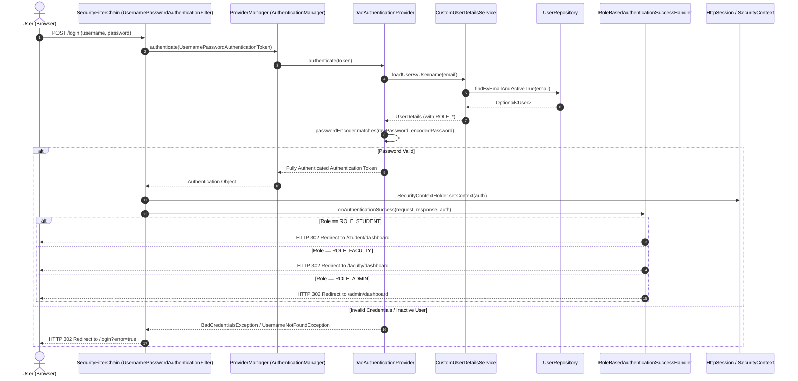

# Authentication Flow
## Exam Question Re-evaluation & Review Management System

### 1. Authentication Overview
The application uses **Spring Security 6** with session-based cookie authentication and BCrypt password encryption ($2^{10}$ hashing rounds). Form-based login handles authentication requests at `/login`.

---

### 2. Sequence Diagram: User Authentication

---

### 3. Key Components
1. **`CustomUserDetailsService`**:
   - Queries `UserRepository.findByEmailAndActiveTrue(email)`.
   - Maps the database `User` entity to Spring Security's `UserDetails` contract.
   - Prepends `ROLE_` to the database role string (e.g. `ROLE_STUDENT`, `ROLE_FACULTY`, `ROLE_ADMIN`).
   - Ensures inactive accounts cannot authenticate.

2. **`BCryptPasswordEncoder`**:
   - One-way cryptographically secure salted hash generator.
   - Prevents plain-text password leakage.

3. **`RoleBasedAuthenticationSuccessHandler`**:
   - Inspects the authenticated user's granted authorities.
   - Directs students to `/student/dashboard`, faculty to `/faculty/dashboard`, and admins to `/admin/dashboard`.
   - Falls back safely to `/` for unrecognized roles.

4. **Session Management & Logout**:
   - Invalidation of HTTP session on logout.
   - Clear cookies and purge `SecurityContextHolder`.
