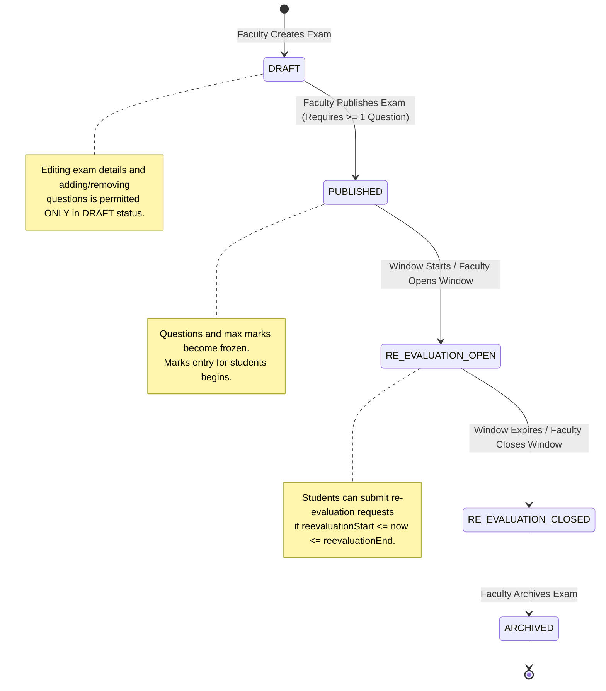

# Examination Workflow & Lifecycle Management
## Exam Question Re-evaluation & Review Management System

### 1. Examination Lifecycle State Machine
The lifecycle of an examination is strictly controlled by `ExamStatus` enum transitions in `ExamService`.

---

### 2. Transition Rules and Constraints

| Source Status | Target Status | Pre-conditions & Validation Rules | Action Performed |
|---|---|---|---|
| *Initial* | `DRAFT` | Title $\ge 3$ characters, Subject valid, Start Date before End Date | Creates new Exam entity |
| `DRAFT` | `DRAFT` | Modifying title, dates, or adding questions | Allowed only in `DRAFT` |
| `DRAFT` | `PUBLISHED` | Must have at least 1 configured Question with $maxMarks > 0$ | Freezes questions, opens exam for grading |
| `PUBLISHED` | `RE_EVALUATION_OPEN` | Re-evaluation start date $\le$ current time $\le$ end date | Allows students to submit recheck requests |
| `RE_EVALUATION_OPEN` | `RE_EVALUATION_CLOSED` | Re-evaluation deadline reached or manual closure | Blocks any new re-evaluation submissions |
| `RE_EVALUATION_CLOSED` | `ARCHIVED` | All pending reviews addressed | Closes exam from active dashboards |

---

### 3. Immutability Enforcement
Once an exam moves from `DRAFT` to `PUBLISHED`:
- Any call to `ExamService.addQuestionToExam()` throws `InvalidStateTransitionException`.
- Any call to `ExamService.updateExam()` attempting to modify questions throws `InvalidStateTransitionException`.
- This ensures historical integrity: student marks and dispute analytics are never invalidated by post-facto question deletions or score weight alterations.
