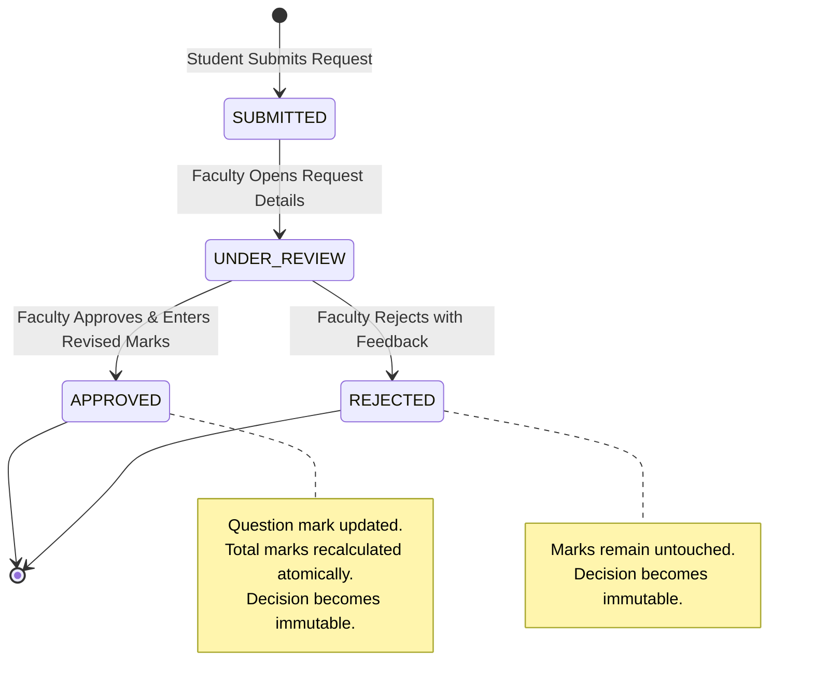
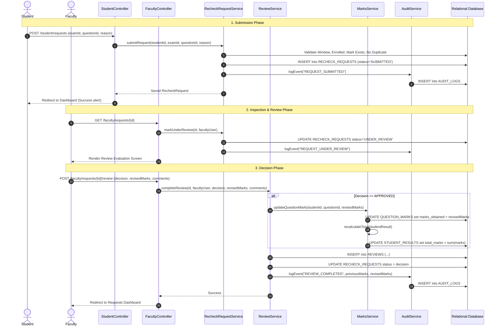

# Re-evaluation Workflow & Request Lifecycle
## Exam Question Re-evaluation & Review Management System

### 1. Re-evaluation Lifecycle Overview
The core value proposition of the system is granular, question-level re-evaluation. A request progresses through four discrete states:
`SUBMITTED → UNDER_REVIEW → APPROVED / REJECTED`.

---

### 2. Detailed Request Sequence Flow

---

### 3. Business Constraints & Immutability Rules
1. **Window Guard**: Submissions are permitted only while `exam.reevaluationStart <= now <= exam.reevaluationEnd` and `exam.status == RE_EVALUATION_OPEN`.
2. **Duplicate Guard**: Enforced at both application level and database level (`UNIQUE(student_id, exam_id, question_id)`).
3. **Immutability of Decisions**: Once a request reaches `APPROVED` or `REJECTED`, any subsequent review invocation throws `InvalidStateTransitionException`.
4. **Marks Bounds**: If approved, revised marks must satisfy $0.0 \le \text{revisedMarks} \le \text{question.maxMarks}$.
