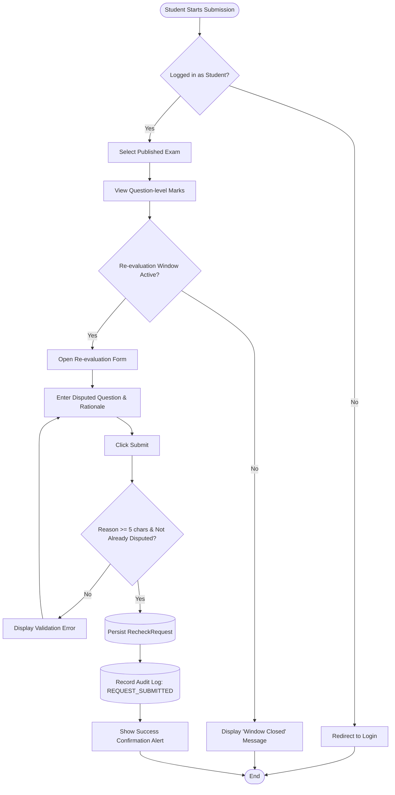

# Activity Diagrams
## Exam Question Re-evaluation & Review Management System

### 1. Student Re-evaluation Submission Activity Flow

---

### 2. Exported Diagram Files
- SVG Vector: [activity-diagram.svg](activity-diagram.svg)
- PNG Raster: [activity-diagram.png](activity-diagram.png)
