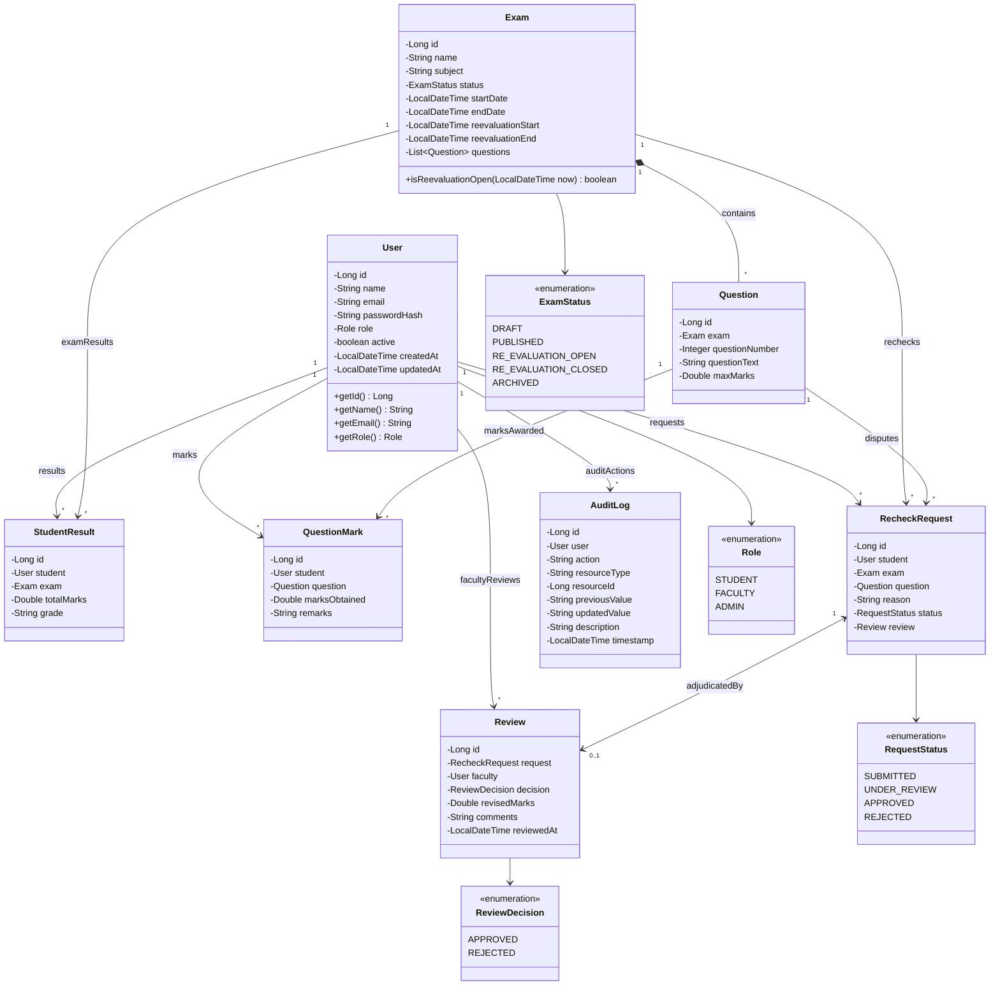

# UML Class Diagram
## Exam Question Re-evaluation & Review Management System

### 1. Class Diagram Specification

---

### 2. Exported Diagram Files
- SVG Vector: [class-diagram.svg](class-diagram.svg)
- PNG Raster: [class-diagram.png](class-diagram.png)
