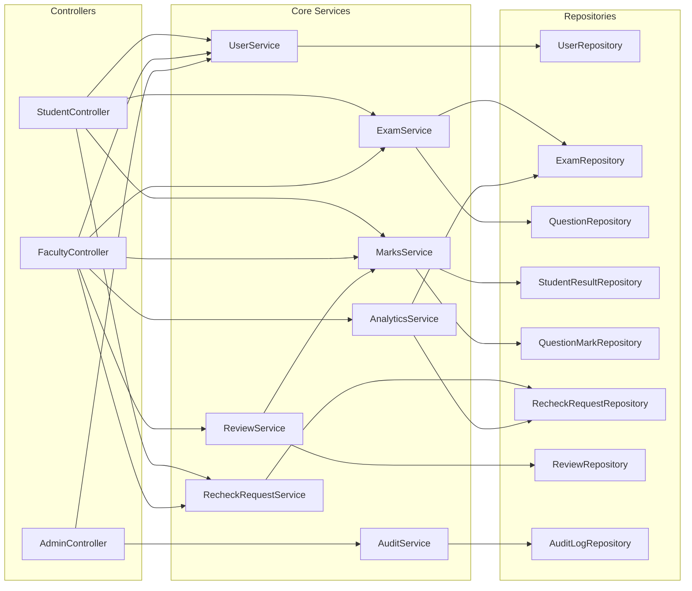

# Component Interactions Diagram
## Exam Question Re-evaluation & Review Management System

### 1. Component Interaction Topology

---

### 2. Exported Diagram Files
- SVG Vector: [system-architecture.svg](system-architecture.svg)
