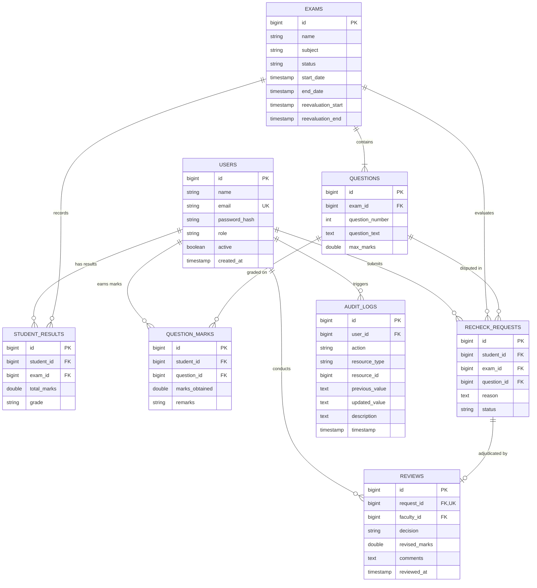

# Entity Relationship (ER) Diagram
## Exam Question Re-evaluation & Review Management System

### 1. ER Diagram Specification

---

### 2. Exported Diagram Files
- SVG Vector: [er-diagram.svg](er-diagram.svg)
- PNG Raster: [er-diagram.png](er-diagram.png)
