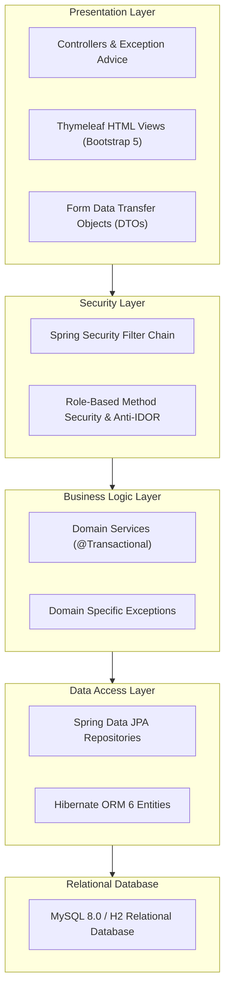

# Layered Architecture Diagram
## Exam Question Re-evaluation & Review Management System

### 1. Layered Architecture

---

### 2. Exported Diagram Files
- SVG Vector: [layered-architecture.svg](layered-architecture.svg)
- PNG Raster: [layered-architecture.png](layered-architecture.png)
