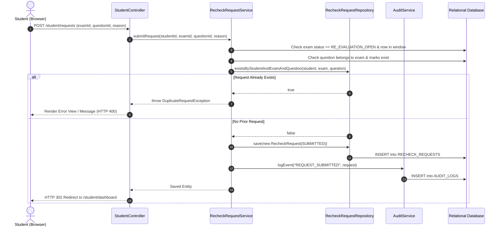
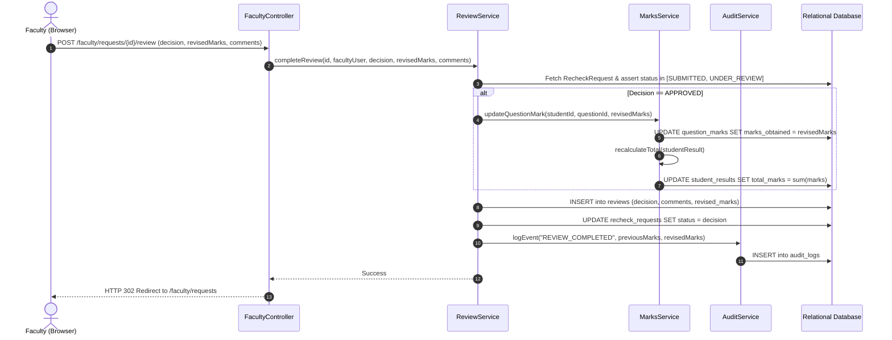

# Sequence Diagrams
## Exam Question Re-evaluation & Review Management System

### 1. Request Submission Sequence Flow

---

### 2. Faculty Review Sequence Flow

---

### 3. Exported Diagram Files
- Sequence Diagram (Submission): [sequence-diagram-submission.svg](sequence-diagram-submission.svg) | [PNG](sequence-diagram-submission.png)
- Sequence Diagram (Review): [sequence-diagram-review.svg](sequence-diagram-review.svg) | [PNG](sequence-diagram-review.png)
