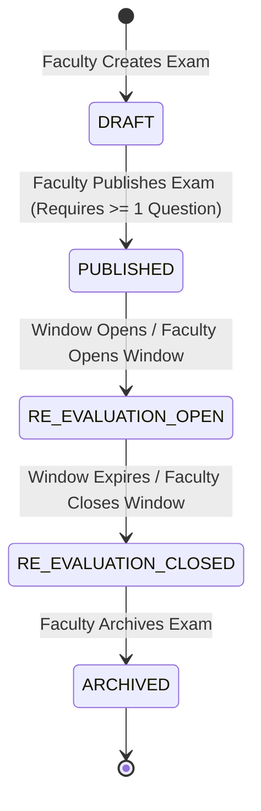
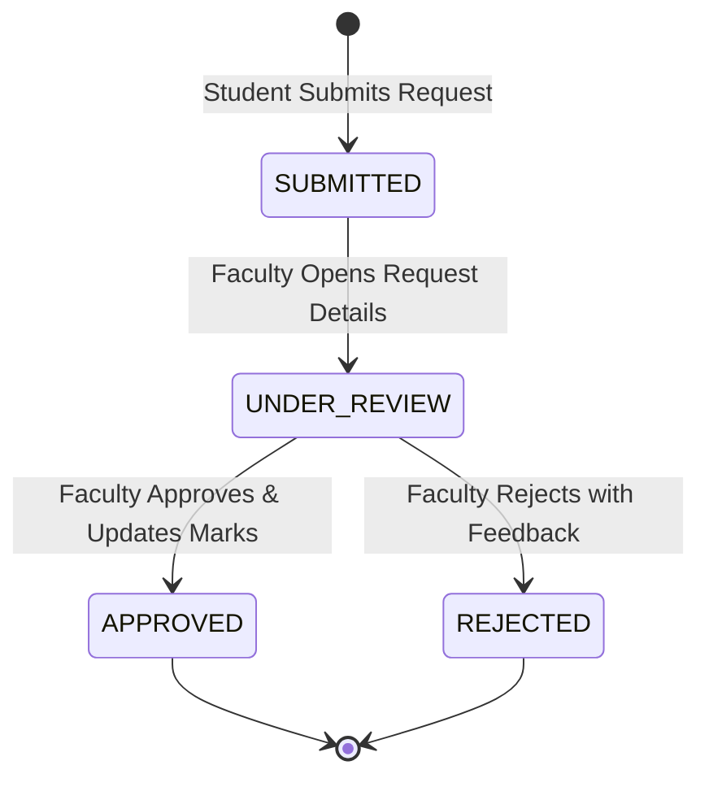

# State Diagrams
## Exam Question Re-evaluation & Review Management System

### 1. Examination Lifecycle State Machine

- SVG Vector: [exam-state-diagram.svg](exam-state-diagram.svg)
- PNG Raster: [exam-state-diagram.png](exam-state-diagram.png)

---

### 2. Re-evaluation Request Lifecycle State Machine

- SVG Vector: [request-state-diagram.svg](request-state-diagram.svg)
- PNG Raster: [request-state-diagram.png](request-state-diagram.png)
