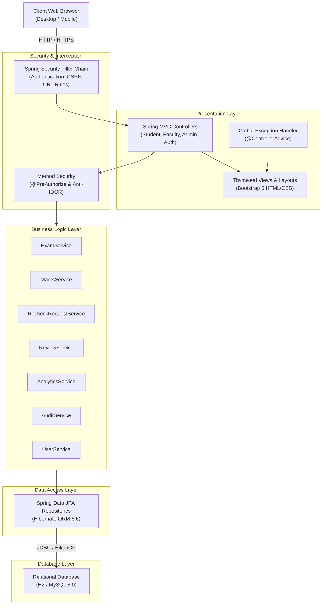

# System Architecture Diagram
## Exam Question Re-evaluation & Review Management System

### 1. High-Level Architecture

The system is deployed as a layered, modular monolith running Spring Boot 3 on Java 21 LTS with server-side rendered Thymeleaf templates.

---

### 2. Exported Diagram Files
- SVG Vector: [system-architecture.svg](system-architecture.svg)
- PNG Raster: [system-architecture.png](system-architecture.png)
