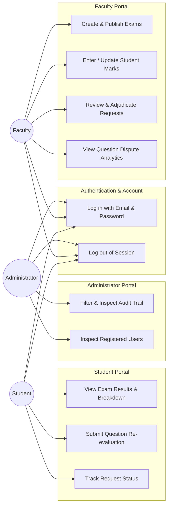

# UML Use Case Diagram
## Exam Question Re-evaluation & Review Management System

### 1. Use Case Diagram Specification

---

### 2. Exported Diagram Files
- SVG Vector: [use-case-diagram.svg](use-case-diagram.svg)
- PNG Raster: [use-case-diagram.png](use-case-diagram.png)
