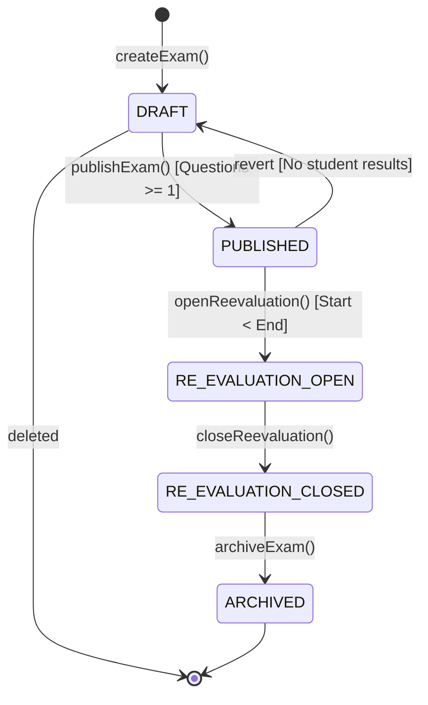

# Phase 3 — Examination & Question Management
## Exam Question Re-evaluation & Review Management System

**Phase Status**: `COMPLETED`  
**Execution Date**: November 18, 2026  
**Lead Architect**: Senior Software Architect & Lead Backend Engineer  

---

## 1. Objectives & Requirements

Phase 3 implements comprehensive examination and question lifecycle management for Faculty and Administrators:
- **Examination Creation**: Configurable exam parameters (Title, Subject, Start Date, End Date).
- **Question Configuration**: Dynamic question statement and positive maximum marks configuration (`maxMarks > 0`).
- **Examination Editing**: Updating title, subject, and scheduling dates in valid lifecycle states (`DRAFT`, `PUBLISHED`).
- **Question Management**: Adding, editing, and listing questions per examination.
- **Strict Lifecycle State Machine**:
  `DRAFT → PUBLISHED → RE_EVALUATION_OPEN → RE_EVALUATION_CLOSED → ARCHIVED`
- **Validation Guards**:
  - Prevent publishing examinations with zero questions.
  - Prevent opening re-evaluation directly from `DRAFT`.
  - Prevent modifying metadata once re-evaluation is open or concluded.
  - Prevent invalid state regression (e.g. `CLOSED` back to `DRAFT`).
  - Enforce backend role authorization (`FACULTY` or `ADMIN`).

---

## 2. Architectural Design & Implementation

### 2.1 Examination State Machine (`ExamService.java`)
A deterministic state transition system was built into `ExamService.updateStatus`, enforcing transitions:

### 2.2 Key Methods Implemented in `ExamService`
1. `createExam(Exam exam, List<Question> questions, User actor)`:
   - Sets default state `DRAFT`.
   - Validates non-blank name and subject.
   - Enforces `maxMarks > 0` for all questions.
   - Automatically sequences question numbers (`1, 2, ...`).
   - Logs audit event `EXAM_CREATED`.
2. `publishExam(Long examId, User actor)`:
   - Validates current state is `DRAFT`.
   - Validates that the examination contains at least 1 question.
   - Validates that all questions have valid positive `maxMarks`.
   - Transitions state to `PUBLISHED` and logs `EXAM_PUBLISHED`.
3. `openReevaluation(Long examId, LocalDateTime start, LocalDateTime end, User actor)`:
   - Validates current state is `PUBLISHED`.
   - Validates `start` is before `end`.
   - Sets `reevaluationStart` and `reevaluationEnd`, transitions state to `RE_EVALUATION_OPEN`, logs `REEVALUATION_OPENED`.
4. `closeReevaluation(Long examId, User actor)`:
   - Validates current state is `RE_EVALUATION_OPEN`.
   - Sets state to `RE_EVALUATION_CLOSED`, logs `REEVALUATION_CLOSED`.
5. `updateExam(Long examId, String name, String subject, LocalDate startDate, LocalDate endDate, User actor)`:
   - Guards against editing when `status` is `RE_EVALUATION_OPEN`, `RE_EVALUATION_CLOSED`, or `ARCHIVED`.
   - Updates fields and logs `EXAM_UPDATED`.
6. `addQuestionToExam(Long examId, Integer questionNumber, String questionText, Double maxMarks, User actor)`:
   - Validates exam is in `DRAFT` or `PUBLISHED`.
   - Validates `questionText` not blank and `maxMarks > 0`.
   - Auto-assigns next question number if omitted.

### 2.3 Form DTO Layer (`com.example.examreview.dto.ExamFormDto`)
- Encapsulates form binding with validation constraints (`@NotBlank`, `@Size`, `@DateTimeFormat`).

### 2.4 User Interface Additions
- **`templates/faculty/exam-edit.html`**: Interactive editor for examination details and real-time question configuration.
- **`templates/faculty/exams.html`**: Status badges, contextual "Edit", "Publish", "Open Re-eval", and "Close Re-eval" action controls.

---

## 3. Files Created & Modified

| File Path | Action | Description |
|---|---|---|
| `service/ExamService.java` | Modified | Added lifecycle validation, editing, publishing, question addition, and audit integration. |
| `controller/FacultyController.java` | Modified | Added `/exams/{id}/edit`, `/exams/{id}/publish`, and `/exams/{id}/questions` endpoints. |
| `dto/ExamFormDto.java` | Created | Structured Data Transfer Object for exam input validation. |
| `templates/faculty/exam-edit.html` | Created | Faculty examination and question configuration template. |
| `templates/faculty/exams.html` | Modified | Updated action buttons and lifecycle controls. |
| `test/.../service/ExamLifecycleTests.java` | Created | 11 unit/integration tests verifying examination lifecycle and state transitions. |

---

## 4. Testing & Verification

Executed `ExamLifecycleTests` via Maven Surefire:
1. `testCreateExamWithQuestions`: Verified exam creation in `DRAFT` with initial questions.
2. `testPublishExamSuccess`: Verified `DRAFT` → `PUBLISHED` transition with question verification.
3. `testPublishExamFailsWithZeroQuestions`: Verified `ValidationException` when attempting to publish an empty exam.
4. `testOpenReevaluationFromPublished`: Verified `PUBLISHED` → `RE_EVALUATION_OPEN` with date window enforcement.
5. `testOpenReevaluationFailsFromDraft`: Verified `InvalidStateTransitionException` when attempting to open re-eval on a `DRAFT` exam.
6. `testCloseReevaluation`: Verified `RE_EVALUATION_OPEN` → `RE_EVALUATION_CLOSED` transition.
7. `testInvalidTransitionFromClosedToDraft`: Verified rejection of illegal backward state regression.
8. `testEditExamMetadataInDraft`: Verified metadata updates in `DRAFT`.
9. `testEditExamMetadataFailsWhenReevaluationOpen`: Verified protection of exam metadata while re-evaluation is open.
10. `testAddQuestionToExam`: Verified question configuration and positive bounds enforcement.
11. `testUnauthorizedUserCannotModifyExam`: Verified non-faculty users are blocked with `UnauthorizedAccessException`.

**Test Results**: 11 tests run, 0 failures, 0 errors, 0 skipped.

---

## 5. Exit Criteria Verification

- [x] Faculty can create, edit, and publish examinations.
- [x] Questions can be configured with strict positive maximum marks.
- [x] Invalid state transitions are intercepted with clear domain exceptions.
- [x] Metadata editing is locked during and after active re-evaluation periods.
- [x] All 11 automated lifecycle tests pass with 100% success rate.
